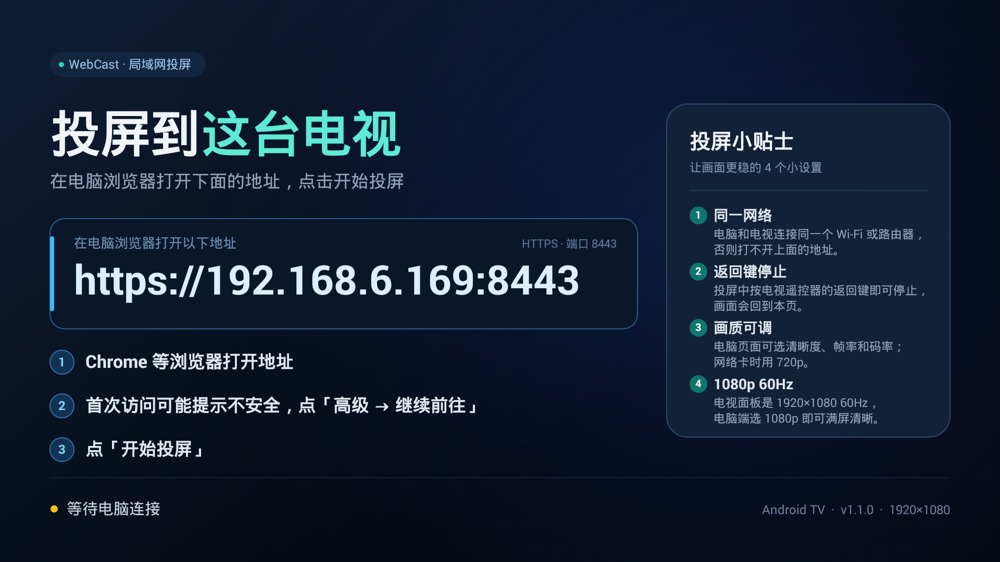
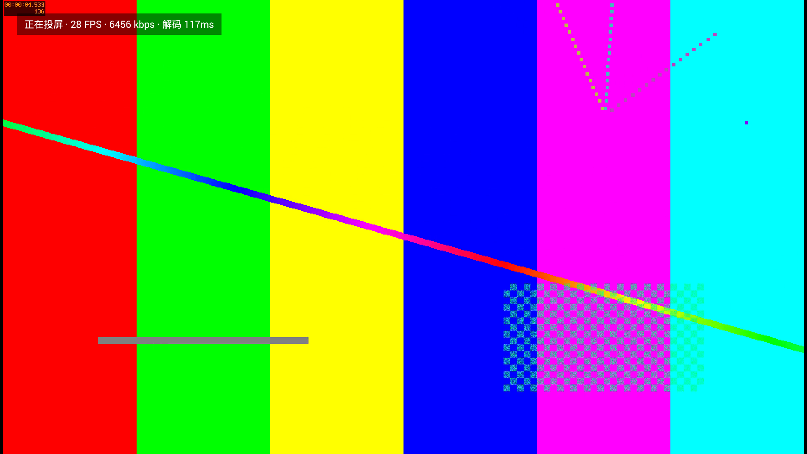

# WebCast — 老电视局域网投屏（Android 4.3 / API18）

**仓库**：[github.com/KawaiiHachimi/WebCast](https://github.com/KawaiiHachimi/WebCast) · **下载 APK**：[Releases](https://github.com/KawaiiHachimi/WebCast/releases/latest)

给 **Android 4.3 电视**（本项目在Android 4.3 电视 上验证）用的局域网投屏接收端：
电视端 App 启动后直接显示一个局域网 HTTPS 地址，并后台运行 Web 服务；**电脑上用 Chrome / Edge 打开这个地址、点「开始投屏」**，电视就能全屏显示电脑画面。

- 电脑端**无需安装任何软件**，只用浏览器（`getDisplayMedia` + WebCodecs）。
- 电视端**不用 WebView 渲染画面**：原生 Java + MediaCodec 硬件解码 + TextureView 全屏显示。
- 参考 [KawaiiHachimi/WebRTC_ScreenShare](https://github.com/KawaiiHachimi/WebRTC_ScreenShare) 的「局域网网页发送、点击投屏」产品思路；
  接收端由 WebRTC/网页改为 **WebCodecs H.264 + WSS + 原生硬解**，因为 Android 4.3 的 WebView 没有 WebRTC，
  libwebrtc 也无法在 API18 上稳定构建。





## 功能

- 电视开机启动 App → 默认全屏待机页：大号地址 `https://<电视IP>:8443`、三步提示、连接状态（不显示二维码，电脑端直接输入地址）。
- 电视后台运行 HTTPS/WSS 服务（8443，HTTP 8080 自动跳转），App 退到后台也不中断服务。
- 电脑打开页面：显示电视型号/分辨率/可解码能力；可自选 **分辨率**（1920×1080 / 1600×900 / 1280×720 / 1024×576）、
  **帧率**（30 / 50 / 60 fps）、**码率**（2–20 Mbps）；声音：关闭 / 共享音频 / 麦克风。
- 自动编码协商（`avc1.42E028` Baseline → `avc1.4D4028` Main）、2 秒关键帧、`need-keyframe` 即时补 IDR、
  按码率自适应的背压（跳过采集帧，不丢已编码帧）。
- 真机实测 1080p60 硬解：59–65 fps、0 丢帧、单帧解码 44–63ms；电视面板为 1920×1080 **60Hz**。
- 电视首帧到达后自动切全屏视频；遥控器**返回键停止投屏**，断开后回到待机页可再次连接。
- 电脑页面可开关电视左上角的「正在投屏 · FPS / 码率」状态条（默认显示，投屏中可切换，记忆选择）。
- 可选声音：48kHz 立体声 PCM → 电视 AudioTrack（真机验证 0 丢帧、0 underrun）。
- 仅接受局域网来源；无远程控制、无文件访问、页面同源，适合家庭局域网。

## 环境要求

| 对象 | 要求 |
| --- | --- |
| 电视 | Android 4.3+（API18，armeabi-v7a），有 H.264 硬解（本项目电视为 `OMX.MS.AVC.Decoder`） |
| 电脑 | 桌面版 Chrome / Edge 94+（推荐最新版），与电视同一局域网 |
| 网络 | 建议 5GHz Wi-Fi 或有线；1080p30 约需 3–8Mbps |

### 首次使用（电脑端）

1. 用 Chrome 等浏览器打开电视上显示的地址（如 `https://192.168.6.169:8443`，直接输入，不使用二维码）。
2. 首次访问可能提示不安全，点 **「高级」→「继续前往」**（一次性；页面仍是安全上下文，屏幕采集可用）。
3. 选择分辨率和帧率（1080p60 需要较好网络）、码率，点「开始投屏」，在共享选择器里选择 **整个屏幕 / 窗口 / 标签页**。
4. **macOS**：首次会要求「屏幕录制」权限（系统设置 → 隐私与安全性 → 屏幕录制 → 勾选 Google Chrome，然后重启 Chrome）。
   未授权时页面会明确提示「无法获取电脑屏幕画面」，不会静默失败。
5. 电视上出现画面后，按遥控器**返回键**即可停止。

## 声音：能传，但受采集端限制

结论：**这项技术不是只能传画面，声音可以传**。本项目已把声音通路做完并真机验证：

- 电脑：display 音轨或麦克风 → `AudioWorklet` 下混 48kHz 立体声 s16le（20ms/3840B 帧）→ WSS。
- 电视：`AudioTrack` 48kHz 立体声播放（Android 4.3 没有 Opus 解码，所以用裸 PCM，局域网带宽足够，约 1.5Mbps）。
  真机 diag：`drops=0 frames, underruns~=0`。

**限制在「电脑端能不能采到系统声音」，不在传输/播放：**

- Chrome `getDisplayMedia` 的音频能力因操作系统而异：
  - Windows / ChromeOS：可勾选「分享系统音频」，能采整个屏幕的声音。
  - macOS：Chrome 通常**只能采集标签页音频**（共享「标签页」时勾选「同时分享标签页音频」），
    共享整个屏幕时一般拿不到系统声音 → 此时可选「麦克风」。
  - DRM/受保护内容可能无法采集。
- 页面在拿不到音轨时会明确提示并自动降级为「仅画面」，不影响投屏。
- v1 不做严格 A/V 时间戳同步，音频大约比画面晚 100–200ms（局域网投屏可接受）。

## 安装与构建

```bash
cd webcast
./tools/make-cert.sh            # 生成自签名证书（首次；已内置则跳过）
./build.sh                      # aapt + javac + d8 + apksigner，无 Gradle、无网络依赖
adb install -r dist/WebCast.apk
adb shell am start -n app.webcast/.MainActivity
```

- 构建需要：JDK 17+（脚本会自动尝试 Android Studio JBR）、Android SDK platform android-18、build-tools。
- 目标 APK：`dist/WebCast.apk`（约 0.9MB，DEX 035、仅 v1 签名，兼容 4.3；当前版本 v1.1.0）。
- 真机需要 `adb root`（userdebug 固件）才能安装；连电视的 adb 也可走网络 `adb connect <电视IP>:5555`。

## 架构

```
┌────────────────────── 电脑 Chrome ──────────────────────┐      ┌────────────── 电视 Android 4.3 App ──────────────┐
│ getDisplayMedia / 麦克风                                │      │ CastService（前台服务，App 退后台服务不断）      │
│   │                                                    │      │   ├─ WebServer: Conscrypt TLS1.2/1.3 + HTTPS     │
│   ├─ video: requestVideoFrameCallback → canvas 缩放      │      │   │   ├─ GET /  /app.js  /api/info  页面资源    │
│   │        → WebCodecs VideoEncoder(H.264, realtime)    │ WSS  │   │   └─ WS /ws  文本控制 + 二进制媒体帧        │
│   │        → video-config(avcC) + AVCC 帧 ──────────────┼─────►│   ├─ MediaCodec OMX.MS.AVC.Decoder → TextureView  │
│   └─ audio: AudioWorklet 48k 立体声 s16le ──────────────┼─────►│   └─ AudioTrack 48k stereo                      │
└─────────────────────────────────────────────────────────┘      │ MainActivity: 待机页(地址) ↔ 全屏视频           │
                                                                  └──────────────────────────────────────────────────┘
```

- **为什么 HTTPS**：`getDisplayMedia` 只在 secure context 可用。API18 原生 JSSE 无法与 Chrome 156 握手，
  因此内置 **Conscrypt 2.5.3（BoringSSL，含 ARMv7 native）** 作为 TLS 服务端，实测 TLS1.3 / ChaCha20。
- **为什么用 TextureView（而不是 SurfaceView）**：这台 MStar 电视上 SurfaceView 路径解码正常、HWC 图层也在合成列表里，
  但面板实际黑屏；改用 TextureView（GPU 在 App 窗口内合成）后画面正常。1080p60 下 GPU 合成仍有余量。
- 协议细节见 [PROTOCOL.md](PROTOCOL.md)，内部接口见 [docs/INTERFACES.md](docs/INTERFACES.md)。

## 目录

```
webcast/
├── build.sh                     # 免 Gradle 构建 APK
├── PROTOCOL.md                  # 电视 ↔ 浏览器 协议 v1
├── app/
│   ├── AndroidManifest.xml
│   ├── src/app/webcast/
│   │   ├── MainActivity.java    # 全屏 UI：待机页 + SurfaceView + 状态浮层
│   │   ├── CastService.java     # 服务：WebServer + CastPlayer 编排、统计、通知
│   │   ├── net/                 # LanAddress / TlsContext / WebServer(HTTPS+WS)
│   │   ├── media/               # H264Util / VideoDecoder / AudioPlayer / CastPlayer
│   │   └── ui/IdleView.java     # 原生 Canvas 待机页（地址/提示/状态）
│   ├── assets/web/              # 电脑端页面：index.html / app.js / style.css / worklet.js
│   ├── assets/tls/              # 自签名证书 cert.pem + key.pk8（不提交私钥）
│   └── res/
├── third_party/conscrypt/       # TLS 服务端（Apache-2.0，含 ARMv7/x86 native）
├── tools/                       # make-cert.sh / mock-ws.js / run-media-tests.sh
├── tests/media/                 # H264Util 纯 JVM 单测（68 项）
└── docs/                        # INTERFACES / UI / MEDIA / SENDER / VERIFY + 截图
```

## 测试

```bash
./build.sh                                  # 构建
./tools/run-media-tests.sh                  # 媒体单测：68 passed
node --check app/assets/web/app.js app/assets/web/worklet.js
```

端到端（手动，最贴近真实环境）：

```bash
# 1) 电视端日志
adb logcat -c && adb logcat -s WebCastTls WebCastWeb WebCastService WebCastMedia
# 2) 电脑 Chrome/Edge 打开 https://<电视IP>:8443，点「开始投屏」
# 3) 观察：WebCastMedia 出现 MediaCodec started / first video frame rendered / 每秒 stats
# 4) 验证电视画面、状态条开关（电脑页面「投屏状态条」）、返回键停止
```

完整验证记录与证据（型号、TLS、硬解、帧率、音频、截图、未验证项）见 [docs/VERIFY.md](docs/VERIFY.md)。

## 已知限制

- 同一时间只支持一台电脑推流；新的连接会替换旧连接。
- 自签名证书：首次需点「高级 → 继续前往」；证书私钥内置于 APK（局域网工具，勿用于公网）。
- macOS 需要给 Chrome「屏幕录制」权限；macOS 共享整屏时通常没有系统声音（见上）。
- A/V 无精确同步；音频约晚 100–200ms。
- 不支持 DRM/受保护视频（会黑屏）。
- 接收端仅 H.264 Baseline/Main ≤ 1080p；发送端不提供 H.265/VP9
  （电视侧虽有 HEVC 解码器，但浏览器 WebCodecs 的 H.265 **编码**支持太差，实测 Edge 不可用，故未启用）。
- 60fps / 高码率对网络要求更高：2.4GHz Wi-Fi 建议 ≤8Mbps、优先 30fps；5GHz 或有线可上 1080p60。
- 电视面板会按内容在 50/60Hz 间切换；以 `adb shell dumpsys display` 的当前刷新率为准。

## 许可与致谢

- TLS：Conscrypt 2.5.3，Apache-2.0，见 `third_party/conscrypt/`。
- 产品思路参考 [KawaiiHachimi/WebRTC_ScreenShare](https://github.com/KawaiiHachimi/WebRTC_ScreenShare)（MIT 之外以原仓库为准）。
- 项目源码：内部项目，按需分发。
